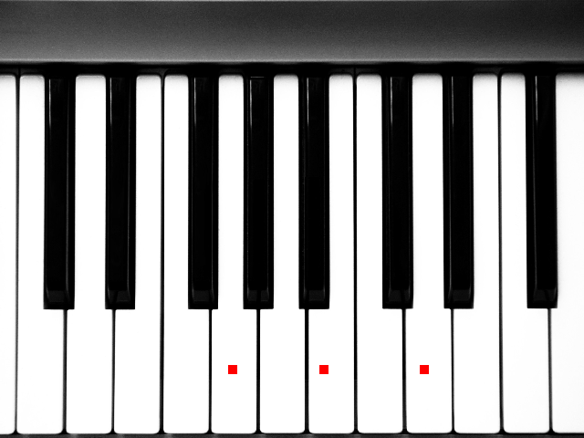

# BlockyMusic - A python piano!

Play the piano with your keyboard. Input (and stunning visuals) powered by [PyGame](https://www.pygame.org/docs/). Audio powered by [pysinenew.py](pysinenew.py), a custom synthasizer I made that generates samples of sine waves using [NumPy](https://numpy.org/) and plays them directly using [PyAudio](https://people.csail.mit.edu/hubert/pyaudio/).

Hold **G**, **J**, and **L** together to play the G major chord shown below.



## Run locally

With Python 3.6.8 or newer, run these commands from the project directory.

```
pip install .
python main.py
```

## Keyboard controls

| Keys | Notes or action |
| --- | --- |
| A S D F G H J K L `;` `'` Enter | White keys: C4 D4 E4 F4 G4 A4 B4 C5 D5 E5 F5 G5  |
| W E T Y U O P `]` | Black keys:  C#4 D#4 F#4 G#4 A#4 C#5 D#5 F#5 |
| Up Arrow / Down Arrow | Shift the keyboard up or down an octave |
| Z | Play “Heart and Soul” |
